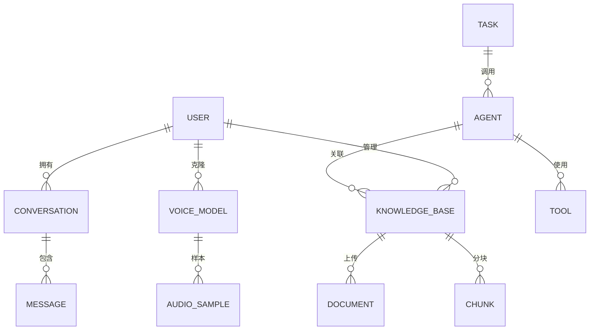

# AI 综合业务平台 - 需求文档

> **项目名称**：CoolAI 智能业务平台  
> **版本**：V1.0.0  
> **日期**：2026-05-13  
> **作者**：CoolAI Team

---

## 1. 项目概述

### 1.1 项目背景

随着大语言模型（LLM）、多模态AI技术的快速发展，企业对AI能力的需求日益增长。本项目旨在构建一个**一站式AI业务平台**，整合AI Agent智能代理、RAG知识库增强、MCP模型上下文协议等前沿技术，提供从智能对话到音视频生成的完整AI服务能力。

### 1.2 项目目标

| 目标类别 | 具体描述 |
|---------|----------|
| **核心能力** | 构建模块化、可扩展的AI能力中台 |
| **业务功能** | 支持AI聊天、RAG知识库、声音克隆、TTS语音合成 |
| **用户体验** | 提供现代化、管理友好的Web界面 |
| **运维保障** | 实现容器化部署、完整监控告警体系 |
| **代码质量** | 详尽中文注释，便于学习理解 |

### 1.3 目标用户

| 用户角色 | 使用场景 |
|---------|----------|
| **企业管理员** | 系统配置、用户管理、运营统计、运维监控 |
| **业务运营** | 知识库管理、AI能力调用、业务数据分析 |
| **开发人员** | API集成、技能扩展、二次开发 |
| **终端用户** | 通过API或界面使用AI服务 |

---

## 2. 功能需求详述

### 2.1 功能优先级矩阵

```mermaid
graph TD
    P0[P0 - 核心必做] --> AI聊天
    P0 --> RAG知识库
    P0 --> 声音克隆
    P0 --> TTS文字转语音
    
    P1[P1 - 扩展功能] --> AI唱歌
    P1 --> 视频生成
    
    P2[P2 - 规划功能] --> 人物替换
    
    P0 -.-> AI聊天: 智能对话
    P0 -.-> RAG: 知识增强
    P0 -.-> 声音克隆: 个性化音色
    P0 -.-> TTS: 语音合成
```

### 2.2 P0 功能模块

#### 2.2.1 AI聊天模块

| 功能点 | 详细描述 | 验收标准 |
|-------|---------|---------|
| 多轮对话 | 支持上下文关联的连续对话 | 支持100轮以上上下文 |
| 多模型切换 | 支持ChatGLM4、Qwen2.5、GPT-4等 | 一键切换模型 |
| 会话管理 | 创建、保存、加载、删除对话 | 支持会话导出 |
| 参数配置 | temperature、top_p、max_tokens等 | 可视化调节 |
| 流式输出 | 支持SSE流式响应 | 打字机效果 |

**用户故事**：
```
作为用户，我希望与AI进行多轮连续对话，
以便在复杂问题上获得连贯的解答。
```

#### 2.2.2 RAG知识库模块

| 功能点 | 详细描述 | 验收标准 |
|-------|---------|---------|
| 文档上传 | 支持PDF、Word、TXT、Markdown等 | 单文件≤100MB |
| 智能分块 | 支持语义分块、固定分块 | 可配置块大小 |
| 向量存储 | 支持Milvus/Qdrant向量数据库 | 毫秒级检索 |
| 混合检索 | 关键词+向量混合搜索 | RRF融合排序 |
| 知识关联 | 支持知识库绑定到Agent | 一键关联 |
| 效果评估 | 支持检索命中率测试 | 评分可视化 |

**用户故事**：
```
作为运营人员，我希望上传企业知识库，
让AI能够基于真实文档回答专业问题。
```

#### 2.2.3 声音克隆模块

| 功能点 | 详细描述 | 验收标准 |
|-------|---------|---------|
| 样本上传 | 支持30秒以上音频 | 自动VAD切分 |
| 声纹提取 | 自动提取声音特征 | 声纹可视化 |
| 模型训练 | 基于样本微调声音模型 | 训练进度展示 |
| 声音管理 | 声音库CRUD操作 | 预览播放 |
| API调用 | 集成到TTS服务 | 支持SDK调用 |

**用户故事**：
```
作为内容创作者，我希望克隆自己的声音，
批量生成配音内容，提高工作效率。
```

#### 2.2.4 TTS文字转语音模块

| 功能点 | 详细描述 | 验收标准 |
|-------|---------|---------|
| 文本输入 | 支持纯文本、SSML标记 | 最大10000字 |
| 音色选择 | 内置音色 + 自定义克隆声音 | 预览播放 |
| 参数调节 | 语速、音调、停顿 | 可视化滑块 |
| 多格式输出 | MP3、WAV、OGG格式 | 高保真音质 |
| 批量合成 | 支持批量文本任务 | 任务队列管理 |

**用户故事**：
```
作为配音师，我希望将文字快速转为语音，
选择不同音色，快速生成多样化的配音内容。
```

---

## 3. 非功能需求

### 3.1 性能需求

| 指标 | 要求 | 说明 |
|-----|------|-----|
| API响应时间 | P95 < 3s | 排除AI模型推理时间 |
| 并发支持 | ≥100并发 | 水平扩展能力 |
| 可用性 | ≥99.5% | 年故障时长<44小时 |
| 存储容量 | 支持PB级 | 按需扩展 |

### 3.2 安全需求

| 类别 | 要求 |
|-----|------|
| 认证授权 | JWT + RBAC权限控制 |
| 数据加密 | 传输TLS 1.3，存储AES-256 |
| 审计日志 | 记录所有操作行为 |
| 敏感词过滤 | 集成内容安全审核 |

### 3.3 兼容性需求

| 类型 | 要求 |
|-----|------|
| 浏览器 | Chrome/Firefox/Safari/Edge最新两个版本 |
| API | RESTful API + WebSocket |
| SDK | Python / JavaScript / Go |

---

## 4. 数据需求

### 4.1 核心数据实体



### 4.2 主要数据表

| 表名 | 说明 | 主要字段 |
|-----|------|---------|
| users | 用户表 | id, username, email, password_hash, role |
| conversations | 对话会话 | id, user_id, title, model, created_at |
| messages | 消息记录 | id, conv_id, role, content, tokens |
| knowledge_bases | 知识库 | id, user_id, name, description, config |
| documents | 文档 | id, kb_id, filename, size, status |
| chunks | 文本块 | id, doc_id, content, vector_id |
| voice_models | 声音模型 | id, user_id, name, model_path, status |
| tts_tasks | TTS任务 | id, user_id, text, voice_id, status |

---

## 5. 验收标准

### 5.1 功能验收

- [ ] AI聊天：完成多轮对话，支持模型切换
- [ ] RAG知识库：完成文档上传→分块→检索→回答的完整链路
- [ ] 声音克隆：完成样本上传→训练→合成流程
- [ ] TTS：完成文本→语音转换，支持参数调节

### 5.2 技术验收

- [ ] 所有代码包含中文注释
- [ ] API文档完整（OpenAPI/Swagger）
- [ ] 单元测试覆盖率 > 60%
- [ ] Docker镜像构建成功
- [ ] docker-compose一键部署成功

### 5.3 运维验收

- [ ] Prometheus指标暴露
- [ ] Grafana监控面板
- [ ] 日志收集配置
- [ ] 告警规则配置

---

## 6. 附录

### 6.1 术语表

| 术语 | 说明 |
|-----|------|
| AI Agent | 人工智能代理，能够自主决策和执行任务 |
| RAG | Retrieval-Augmented Generation，检索增强生成 |
| MCP | Model Context Protocol，模型上下文协议 |
| TTS | Text-to-Speech，文字转语音 |
| RRF | Reciprocal Rank Fusion，排名融合算法 |

### 6.2 参考资料

- LangChain 官方文档：https://python.langchain.com/
- Milvus 向量数据库：https://milvus.io/
- FastAPI 框架：https://fastapi.tiangolo.com/

---

**文档版本历史**

| 版本 | 日期 | 修改内容 | 作者 |
|-----|------|---------|------|
| 1.0.0 | 2026-05-13 | 初始版本 | CoolAI Team |
